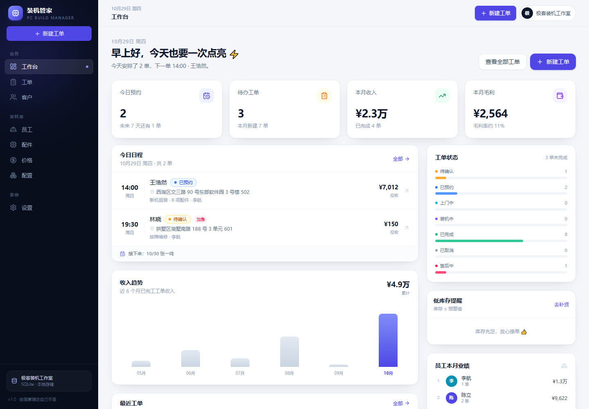
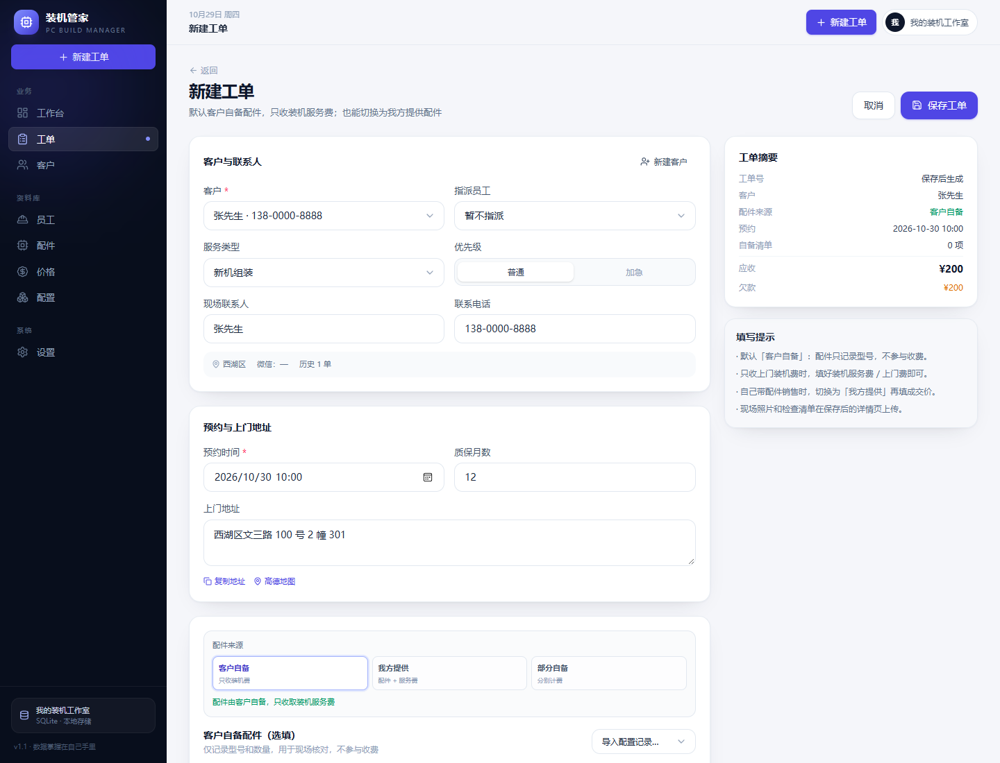
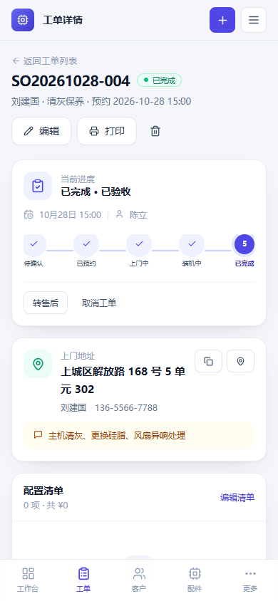

# 装机管家 · 个人上门装机管理系统

> 客户 → 配置报价 → 预约上门 → 现场装机 → 验收收款 → 售后回访，一个系统全管好。  
> 本地部署、手机自适应、数据完全留在自己手里。



> 截图使用可选演示数据；实际首次启动是空库，直接录入自己的客户和工单。

## 功能一览

- **客户自备配件（默认）**：新建工单默认客户自备，配件只记录型号、不计费，只收服务费；也可切换我方提供/部分自备。
- **服务价目表**：标准上门装机、装系统、清灰、检测、水冷/ITX/加急等按项目定价，开单勾选自动合计。
- **上门前确认**：兼容性清单（CPU/内存/显卡/散热/电源/机箱/数据）+ 客户自备件风险确认，打印在验收单。
- **收款流水**：定金、尾款、其他收款、退款分开记录，自动算已收/欠款/结清状态。
- **库存联动**：工单保存按配件自动扣库存，取消/删除/编辑自动回补或重算；支持采购入库、出库、盘点和库存流水。
- **日程排期**：月历视图、当天路线、按日期查看工单，一键安排到指定日期。
- **经营报表**：服务收入/毛利、客单价、服务项目贡献、客户来源、星期/时段分布、客户排行。
- **客户分享页**：生成只读链接发微信，客户可看进度、服务项目、配件、照片和费用（不含内部成本）；可随时撤销链接。
- **报价单 PDF**：服务端直接生成带店铺抬头、服务/配件明细、合计和签名的 A4 报价单，手机可直接发客户。
- **售后回访**：完工后记录回访日期、备注、1-5 星评分；工作台提醒到期回访/保修/待收款。
- **电子签名**：客户在手机/电脑上直接手写签名，保存到工单并打印在验收单上。
- **回收站**：工单、客户、配件删除后先移入回收站，照片/收款/价格留痕，可恢复或彻底删除。
- **员工提成**：员工可设置提成比例，报表按已完工应收自动计算提成。
- **完整备份**：数据库 + 照片视频打包 zip，支持每日自动备份、保留份数、命令行恢复；每个账户独立备份。
- **精简模式**：只做上门服务时隐藏配件、价格、配置、员工模块，界面更清爽。
- **多账户登录**：用户名 + 密码；每个账户独立数据库、客户、工单、配件、服务、员工、设置、照片、备份和分享链接，互不可见。
- **账户管理**：主账户在设置中创建/停用子账户、重置密码；新账户从空库开始，不开放自助注册。
- **工作台 / 客户 / 员工 / 配件 / 价格 / 常用配置 / 现场媒体**：完整业务档案与留痕。
- **数据安全**：每个账户独立 SQLite + 媒体目录，支持 zip 完整备份、JSON 导出和 PWA 安装。

### 客户自备配件开单



| 移动端工作台 | 移动端工单 |
| --- | --- |
|  |  |

## 技术栈

| 层次 | 技术 |
| --- | --- |
| 前端 | React 19 · TypeScript · Vite 6 · Tailwind CSS 4 · React Router 7 · Lucide |
| 后端 | Node.js 22+ · TypeScript（tsx）· 原生 `node:http` |
| 数据 | SQLite（Node 内置 `node:sqlite`）· 本地文件媒体存储 |
| 校验 | Zod |
| 备份 | Archiver（zip 打包）· AdmZip（恢复）· 每日自动备份 |
| PDF | PDFKit + 中文字体（默认 Windows 黑体） |
| 视频转码 | `@ffmpeg-installer/ffmpeg`（随项目安装，HEVC/H.265 → H.264） |
| 测试 | 接口冒烟脚本 · Playwright Core（本机 Edge） |
| 部署 | 单 Node 进程同时托管 SPA 与 API；路由按页懒加载 |

选型理由、数据模型、接口清单、状态机与路线图详见 **[开发文档.md](开发文档.md)**。

## 快速开始

环境要求：**Node.js ≥ 22.13**（推荐 24 LTS）、**pnpm ≥ 9**。

```bash
# 1. 安装依赖
pnpm install

# 2. 构建前端
pnpm build

# 3. 启动（默认 http://127.0.0.1:8787）
pnpm start
```

首次启动是**空库**，只写入通用默认设置，直接录入自己的客户、员工和工单即可。

想先看完整界面，可在首次启动前开启演示数据（之后可在界面删除）：

```powershell
$env:SEED_DEMO = "1"
pnpm start
```

演示数据只在员工表为空时写入一次，不会覆盖已有业务数据。

### 开发模式

```bash
pnpm dev
# API:  http://127.0.0.1:8787
# 前端: http://localhost:5173  （Vite 已代理 /api 与 /uploads）
```

### 常用命令

| 命令 | 说明 |
| --- | --- |
| `pnpm dev` | 同时启动 API 与 Vite 前端 |
| `pnpm build` | TypeScript 检查 + 生产构建 |
| `pnpm start` | 生产模式启动，需先 build |
| `pnpm test:api` | 接口冒烟测试（需服务已启动） |
| `pnpm test:ui` | Playwright 端到端测试（需本机 Edge） |
| `pnpm typecheck` | 仅做类型检查 |

## 配置

| 环境变量 | 默认值 | 说明 |
| --- | --- | --- |
| `PORT` | `8787` | 服务端口 |
| `HOST` | `127.0.0.1` | 监听地址；手机局域网访问改为 `0.0.0.0` |
| `DATA_DIR` | `./data` | 数据库与上传文件目录 |
| `BACKUP_DIR` | `./backups` | 完整备份与自动备份目录 |
| `SEED_DEMO` | 未设置 | 设为 `1` 且员工表为空时写入一套演示数据 |
| `APP_PASSWORD` | `Zzc010423` | 首次启动时创建主账户「小左」的初始密码；之后账户密码存在 `data/accounts.db` |
| `PDF_FONT_PATH` | 自动查找 Windows 黑体/雅黑 | 报价单 PDF 中文字体路径（非 Windows 部署需指定） |
| `FFMPEG_PATH` | 使用项目内置 ffmpeg | 自定义 ffmpeg 可执行文件（可选） |

首次启动后登录：

- 用户名：`小左`
- 初始密码：`.env` 里的 `APP_PASSWORD`（默认 `Zzc010423`）
- 登录后可在「设置 → 账户管理」创建子账户；每个子账户从空库开始

忘记密码可在项目目录执行：

```bash
pnpm reset-password 小左 新密码
```

> 每个账户的数据、照片、备份和分享链接完全独立。客户分享页不需要登录，但只能看到对应账户的工单。

### 局域网访问（手机 / 其他电脑）

项目根目录已准备好 `.env`（已加入 `.gitignore`），`pnpm start` 会自动读取：

```ini
HOST=0.0.0.0
PORT=8787
APP_PASSWORD=主账户初始密码
```

首次配置或换网络后，需要放行 Windows 防火墙。直接双击 `scripts\allow-lan-firewall.cmd`，在 UAC 弹窗点「是」即可；或在管理员 PowerShell 中执行：

```powershell
powershell -ExecutionPolicy Bypass -File "D:\VibeCoding\deepseek-learn\PC-System\scripts\allow-lan-firewall.ps1"
```

如果 Windows 弹出“是否允许 Node.js 访问网络”，请选择允许。随后手机和电脑连同一个 Wi-Fi，访问：

```text
http://电脑局域网IP:8787
```

例如电脑局域网 IP 是 `192.168.x.x`，手机打开 `http://192.168.x.x:8787`，输入用户名「小左」和主账户密码。

防火墙脚本只放行本网段（`LocalSubnet`）的 8787 端口；如果路由器开启了“AP 隔离/访客网络隔离”，手机仍然无法访问，需要在路由器里关闭隔离。

## 数据与备份

- 主账户：`data/app.db` + `data/uploads/YYYY-MM/`
- 子账户：`data/accounts/<id>/app.db` + `data/uploads/accounts/<id>/`
- 账户表：`data/accounts.db`（密码哈希、会话、分享映射）
- 设置页的备份/导出只针对**当前登录账户**；主账户和子账户各自独立。
- 自动备份：主账户 `backups/auto/`，子账户 `backups/accounts/<id>/auto/`。
- 恢复：停止服务后执行 `pnpm restore 备份.zip --yes`，系统会先备份当前数据，再解压恢复，最后 `pnpm start`。子账户恢复需把 `DATA_DIR` 指向对应账户目录。
- 重置为空库：停止服务后删除对应账户目录（主账户是 `data/app.db` 与 `data/uploads/`）再启动，请先备份。

## 常见问题

**启动时出现 `ExperimentalWarning: SQLite is an experimental feature`？**  
Node.js 对内置 SQLite 的提示，功能正常，可忽略；不影响数据与性能。

**8787 端口被占用？**  
`PORT=8790 pnpm start`（PowerShell：`$env:PORT=8790; pnpm start`），或关闭占用端口的程序。

**手机怎么访问？**  
把 `HOST` 设为 `0.0.0.0` 后重启，手机与电脑连同一 Wi-Fi，访问 `http://电脑局域网IP:8787`，用账户用户名和密码登录。

**怎么只收装机费？**  
新工单默认就是「客户自备配件」，配件清单留空即可，只填装机服务费/上门费；需要记录客户带来的型号时再登记配件，仍然不计费。

**演示数据可以删吗？**  
默认没有演示数据。如果手动开启了 `SEED_DEMO=1`，客户、工单、配件、配置都能在界面里删除；想彻底重置就停止服务后删除 `data/` 目录再启动。

**照片/视频存在哪里？**  
主账户 `data/uploads/年月/`，子账户 `data/uploads/accounts/<id>/年月/`；数据库只存索引。设置页的「下载完整备份」只打包当前账户的数据库和媒体。

**忘记密码？**  
在项目目录执行 `pnpm reset-password 用户名 新密码`，然后重新登录；主账户同样适用。

## 项目结构

```
├─ 开发文档.md          # 需求、设计、数据模型、接口、技术选型、路线图
├─ server/              # Node API、SQLite、媒体上传、静态服务
├─ shared/types.ts      # 前后端共享类型与业务常量
├─ src/                 # React 页面、组件、API 客户端
├─ scripts/             # 接口冒烟 / Playwright E2E
├─ docs/screenshots/    # 文档截图
├─ backups/             # 旧数据备份（可选，不入库）
└─ data/                # 运行时生成：数据库与媒体（不入库）
```

## 已验证

- `pnpm build`：类型检查通过，生产构建成功。
- `pnpm test:api`：29 项接口测试通过（服务价目表、多地址、自动扣库存、报价单 PDF、分享撤销、客户/配件/工单回收站、员工提成、报表、zip 备份等）。
- `pnpm test:ui`：服务项目默认带出 → 客户自备建单 → 勾兼容性确认 → 上传图片 → 收款 → 打印 → 移入回收站 → 恢复 → 彻底删除 → 移动端，全部通过。
- 已单独验证：手写签名并打印、地址添加/切换、库存入库弹窗与流水、客户/配件回收站、分享链接撤销、HEVC 视频自动转 H.264、空库启动、密码登录/401、zip 恢复脚本。
- 测试脚本自建数据并清理；桌面 1440px / 移动 390px 关键页面无横向溢出、无控制台错误。

## 已知限制与后续计划

当前版本聚焦个人/小团队：库存已联动，但还没有供应商采购单/采购成本流水；PWA 目前是“可添加到桌面”，没有离线缓存；分享链接可撤销但不会自动过期。  
后续优先级：采购单与供应商对账 → 回访自动通知 → 分享链接有效期 → 云同步。

> 视频转码会占用 CPU，超大/超长视频上传后需要等待转码完成；超过 300MB 或极少数新编码可能转码失败，原文件会保留可下载。

---

**文档**：[开发文档.md](开发文档.md) · **技术栈**：React 19 / TypeScript / Tailwind CSS 4 / Node.js / SQLite
